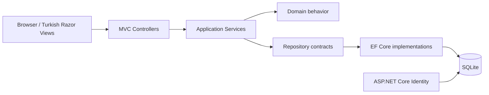
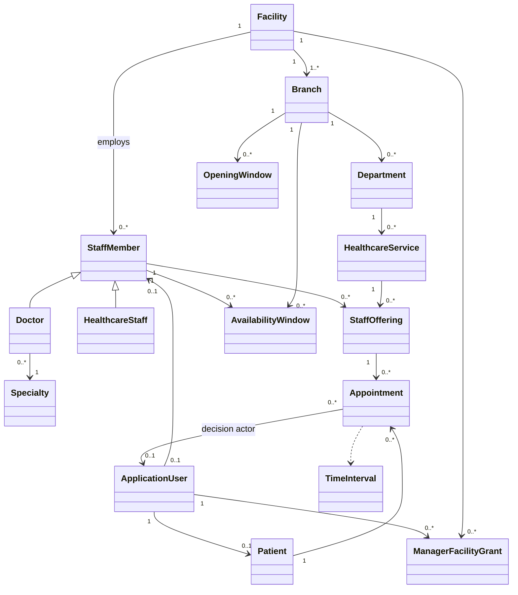

# Approved C# implementation plan

Design approved by the owner. Stages 0–3 are accepted; **Stage 4 review/delivery/presentation is authorized and implemented**, 27 October 2026 (Europe/Istanbul). The one authorized Stage 1–3 checkpoint is pushed and verified as abebdb2d0142ea883af83aa1475b385874d22e79. No additional commit/push is authorized. Actual final evidence is in STAGE4_VERIFICATION.md; earlier reports are historical.

## Grounded baseline

Read-only reference: `C:\Users\muhammed\Desktop\hospital-appointment-system`. New workspace: `C:\Users\muhammed\Desktop\hospital-appointment-system-csharp`. The original teacher DOCX, requirements, plan/UML, architecture review, presentation guide, implementation and eleven test suites were inspected. The original source permits any language; the professor's later explicit C# instruction governs this project.

Installed during planning: .NET SDK **10.0.403**, ASP.NET Core/.NET runtime **10.0.14**, Windows x64. The initial C# directory was empty. Existing Java reports contain 118 historical successful executions and were not rerun. Current C# foundation results are recorded separately in STAGE1_VERIFICATION.md.

Preferences: ASP.NET Core Identity; Turkish user interface and presentation notes; English identifiers and technical documentation. Preserve all T01–T13 application requirements in [REQUIREMENTS.md](../REQUIREMENTS.md), with administrative obligations tracked separately.

## Architecture and project structure

One server-rendered MVC monolith; no separate SPA or public API is needed.

```text
HospitalAppointments.sln
src/
  HospitalAppointments.Domain/
    Facilities/ Catalog/ Staff/ Patients/ Appointments/ Scheduling/
  HospitalAppointments.Application/
    Services/ Contracts/ Repositories/ Security/ Transactions/
  HospitalAppointments.Infrastructure/
    Persistence/ Configurations/ Repositories/ Identity/ Demo/ Migrations/
  HospitalAppointments.Web/
    Controllers/ Models/ Views/ Resources/ wwwroot/
tests/
  HospitalAppointments.Domain.Tests/
  HospitalAppointments.Application.Tests/
  HospitalAppointments.IntegrationTests/
docs/
```

The seven projects, domain model, booking flow and scoped management services/screens now exist. Domain has no project/framework dependencies. Application references Domain. Infrastructure references Application and Domain. Web references Application and Infrastructure to compose DI; controllers receive application services, not DbContext or repositories.



| Layer | Responsibility |
| --- | --- |
| Web controllers/models/views | HTTP, form-shape validation, views and redirects; separate inputs/read models, Turkish validation and display. |
| Application services | Use cases, scheduling, object authorization, transactions, snapshots and orchestration. |
| Repository contracts/implementations | Focused scoped queries and persistence; no business decisions in generic CRUD wrappers. |
| Domain | Encapsulated entities, local invariants, state transitions and immutable intervals; no HTTP, Identity or database calls. |
| Infrastructure | EF mappings/migrations, SQLite transaction implementation, Identity adapter, persistence and demo initialization. |

Use constructor injection, acyclic service collaborations and cancellation tokens. Focused concrete services do not each need an interface. Repository/security/transaction interfaces serve real boundary needs. Avoid MediatR, CQRS infrastructure, generic service frameworks, AutoMapper, speculative patterns and duplicate persistence/domain graphs.

## Dependency baseline

Target net10.0. Stage 1 pins SDK 10.0.403 with patch-only roll-forward and nullable reference types. Central package versions, seven lock files and a root dotnet-tools.json local tool manifest are implemented. Microsoft.Extensions.TimeProvider.Testing remains deferred until a time-sensitive business use case needs it; Stage 1 uses TimeProvider.System and configured TimeZoneInfo without that extra dependency.

| Package/tool | Pinned version |
| --- | --- |
| Microsoft.EntityFrameworkCore.Sqlite | 10.0.14 |
| Microsoft.EntityFrameworkCore.Design (development-only) | 10.0.14 |
| Microsoft.AspNetCore.Identity.EntityFrameworkCore | 10.0.14 |
| Microsoft.AspNetCore.Mvc.Testing (integration tests) | 10.0.14 |
| dotnet-ef local tool | 10.0.14 |
| xunit.v3 | 3.2.2 |
| xunit.runner.visualstudio | 3.1.5 |
| Microsoft.NET.Test.Sdk | 18.0.1 |
| Microsoft.Extensions.TimeProvider.Testing | 10.0.0 |
| Locally packaged Bootstrap CSS/license | 5.3.8 |

Package availability and framework metadata were checked during planning against NuGet's official feed. The SDK does not imply NuGet packages are already restored. Stage 1 must demonstrate locked dependency restore, build and actual test discovery before this baseline is accepted operationally. MVC, Razor and DI use the shared ASP.NET Core framework. First dependency restore needs network access; prepared application assets must work locally without a CDN.

## Java to C# mapping

| Java class/area | C# equivalent |
| --- | --- |
| ClinicApplication | Web Program composition root. |
| Facility, Branch, Department, OpeningWindow | Same domain entities; EF Fluent API mapping outside Domain. |
| HealthcareService | Encapsulated entity with decimal terms and application-managed catalog version. |
| StaffMember, Doctor, HealthcareStaff, Specialty | Preserved abstract hierarchy and required doctor specialty. |
| StaffOffering, AvailabilityWindow | Explicit service eligibility and dated branch availability. |
| Patient, Appointment, AppointmentStatus | Preserved business entities/state flow and snapshots. |
| TimeInterval | Immutable C# value object for overlap, containment and continuous coverage. |
| UserAccount / Role | Infrastructure ApplicationUser plus Identity roles/user-role relationships; no duplicate custom credential system. |
| Account facility associations | Domain ManagerFacilityGrant using scalar account/facility IDs. |
| AccountDetailsService / SecurityConfig | Identity adapter, cookies, authentication and route policies. |
| AccountService / AccessService / ManagementScope | Application account/access and scoped-management use cases. |
| AppointmentService / AvailabilityService | Focused reservation/decision and scheduling services. |
| BookingPageService / ManagementQueryService | Immutable page/read DTO query services. |
| Four management services/controllers | Facility, catalog, staff and schedule application services/MVC controllers. |
| Spring Data repositories | Repository contracts in Application and EF implementations in Infrastructure. |
| @Transactional / row-lock keys | Service-owned transaction boundary with SQLite immediate writer scope; no H2 row-lock translation. |
| Clock | TimeProvider and configured TimeZoneInfo. |
| Java records/forms and Thymeleaf | C# input/read models and Razor Views. |
| Demo initializers | Explicit idempotent synthetic demo initialization. |
| JUnit/Spring tests | xUnit domain/application/integration equivalents. |

## Domain and EF relationships

Use one ApplicationDbContext derived from `IdentityDbContext<ApplicationUser, IdentityRole<long>, long>`. It maps Identity and the domain. Stage 3 reuses the existing schema: no new tables/columns are needed and the pending-model check confirms this. AccountProfile remains an immutable domain read snapshot, not another identity store. Patient/staff/grant/decision references use scalar account IDs; infrastructure defines Identity foreign keys without bringing framework types into Domain. Booking access checks combine current account roles with patient/assigned-staff/facility relationships.



- Facility creation includes its first branch and creator grant atomically; a foreign key alone cannot enforce minimum child count.
- Service → Department → Branch derives its venue/facility. Similar procedures at different branches have independent catalog entries/terms.
- Staff belong to one facility. Offerings link staff/services uniquely; their resource links cannot later be reassigned. No redundant staff/branch membership table is needed.
- Availability is staff/branch/date-specific and independent of individual services. Active service assignment at that branch is required for new availability.
- Patients require a unique account link. Staff accounts are optional/unique; one account can have both profiles. Identity composes roles.
- Appointment links patient/offering and snapshots booked service/staff names, duration, fee/currency, start/end, creation/status and optional decision actor/time.
- Facility/branch names and the professional description shown on an appointment are current linked labels. They are not additional snapshots; renaming these does not alter booked service/staff names or terms.
- Persist staff with **table-per-hierarchy** and a discriminator, replacing Java JOINED inheritance. Check doctor specialty/healthcare-worker job-title consistency. This simplifies SQLite joins without changing C# OOP semantics.

Use private setters/backing fields, validating constructors and named behavior. Do not bind entities to HTTP. Preserve restrictive deletion and deactivate referenced records. Keep navigation loading explicit; return fully prepared read DTOs rather than relying on lazy loading in Razor.

Database integrity: required FKs; scoped name uniqueness matching the reference; normalized username uniqueness; unique staff/service offerings and manager/facility pairs; valid status/discriminator checks; positive intervals; duration 1–1439; exact nonnegative fees; decision actor/time present exactly when decided. Use indexes for patient/time and offering/time, staff offerings and staff/branch availability. Employee conflict queries traverse all offerings, without a branch filter.

Money remains decimal in C# and converts exactly to SQLite integer minor units. Reject fractional kuruş and amounts beyond DECIMAL(12,2)-equivalent bounds (maximum 9,999,999,999.99 TRY). Do not round silently or use floating point. Local form inputs use DateOnly/TimeOnly and Europe/Istanbul. Appointment/availability/audit instants use UTC DateTime, mapped explicitly to integer ticks with UTC kind restored on materialization. Require server-translated comparisons; calculate query boundaries in application code. Duration checks can compare integer tick differences exactly. Weekly hours retain local time/day semantics.

Use EF migrations from Stage 1; apply identical migrations to integration databases. Do not mix EnsureCreated with migrations. Use application-managed concurrency tokens for catalog and appointment updates, not unsupported database-generated rowversion.

## OOP evidence

| Concept | Concrete implementation and explanation |
| --- | --- |
| Encapsulation | Appointment.Approve/Reject, atomic HealthcareService.UpdateDetails, AvailabilityWindow.Reschedule and named activation methods; private state and immutable ownership/resource links. |
| Inheritance | Doctor and HealthcareStaff share real staff identity/employment/eligibility; subtype fields retain real meaning. |
| Abstraction | Abstract staff professional-description contract and focused repository/security/transaction ports. |
| Polymorphism | Mixed staff lists call the shared description member; doctor supplies specialty and healthcare worker supplies job title. Common booking has no staff-type switch. |
| Single responsibility | HTTP, availability calculation, appointment coordination and queries have separate responsibilities. |
| Open/closed / Liskov | Either real staff subtype works through the same booking contract; no unsupported base operations. No claim that a new subtype requires zero changes everywhere. |
| Interface segregation | Small useful repository/use-case boundaries, no universal CRUD interface. |
| Dependency inversion / DI | Services receive ports and time rather than constructing persistence or reading the wall clock directly. |
| Composition | Identity roles, manager grants, offerings and facility structure are relationships rather than a Person/Patient/Doctor/Manager inheritance explosion. |

Professional descriptions expose stored specialty/job-title text; domain code does not depend on Razor/localization resources. The UI supplies Turkish labels.

## Security, public contracts and UI

`BookAsync(BookAppointmentCommand, CancellationToken)` returns the ID. Input contains OfferingId, local Date/StartTime and expected CatalogVersion only. `DecideAsync(appointmentId, decision, CancellationToken)` accepts approve/reject. Acting account comes from a server-side current-actor adapter; services reload eligibility and grants. Never accept patient, audit actor, roles, duration/fee/end or status as trusted booking inputs.

Route policies enforce PATIENT/STAFF/MANAGER groups. Services additionally enforce patient ownership, assigned staff identity, manager facility grant and every child ID's actual scope. Any manager can create a facility and receive its grant atomically. Manager staff registration can provision a new STAFF identity in the same context/transaction; it cannot attach an existing account or grant submitted elevated roles.

Use Identity hashing and five-failure/five-minute login lockout with lockoutOnFailure. Trim usernames, use invariant Identity normalization and validate raw/normalized bounds. Turkish display names are permitted. Use protected POST login/logout, antiforgery for all unsafe MVC methods, local return URLs, Razor encoding and HttpOnly/Lax cookies with HTTPS for the prepared local demo. Do not expose passwords/hashes. No public signup/recovery/role-admin screens in initial scope.

Turkish screens: login/role workspaces; patient catalog → employee → date → valid starts, terms review and Pending result; own appointments/details; assigned staff decisions; manager configuration and scoped appointment review. Status labels include Onay Bekliyor, Onaylandı and Reddedildi. Use Bootstrap, labels, skip links, focus indicators, readable errors, textual statuses and responsive forms/tables. Preserve selections after conflict; handle empty catalogs/no eligible staff/no starts usefully. Technical locking/ORM details belong in documentation, not patient forms.

Core scheduling and concurrency are specified in [CONCURRENCY.md](CONCURRENCY.md). Bookings are future/same-local-day, half-open intervals, 15-minute starts, full coverage of both opening and matching staff availability, with global patient and cross-branch employee conflicts. Pending/Approved reserve; Rejected releases. Snapshots survive catalog edits and deactivation. Decisions are single transitions and remain available after offering deactivation.

## Implemented management module

FacilityManagementController → FacilityManagementService → IFacilityManagementRepository handles owned institutions/branches/departments. CatalogManagementController → CatalogManagementService → ICatalogManagementRepository validates complete service terms. StaffManagementController → StaffManagementService → IStaffManagementRepository and IStaffAccountProvisioner registers either subtype and assigns/deactivates offerings. ScheduleManagementController → ScheduleManagementService → IScheduleManagementRepository plus the existing opening-query port handles validated dated shifts and weekly replacements. ManagementQueryService prepares immutable, credential-free page DTOs through the read repository. ManagementScope centralizes only the shared manager/grant/writer entry checks; it is not a generic CRUD framework.

All repositories/Identity writes share the scoped EF context. Child IDs are checked against their actual owner, not trusted from a route or form. Specialty is a shared immutable dictionary; managers can create/reuse a name through an owned institution but cannot edit other institutions' staff. Existing employee accounts cannot be attached or elevated. The same StaffOffering defines both qualification and branch assignment.

Schedule changes protect future/ongoing reserved intervals (`End > now`, Pending/Approved), using the union of remaining matching shifts plus the proposal. Whole intervals must fit opening periods, including lunch gaps. Other-branch shifts also conflict for the same employee. Opening edits protect future shifts as well as reservations. Staff/service/offering deactivation changes new-booking eligibility while preserving historical rows and decision access. Managers may reactivate; structural resource links are immutable.

The Turkish management fee binder allows comma decimals and forbids implicit thousands grouping; domain validation additionally rejects fractional minor units and bounds violations. Date inputs and defaults use ClinicTime/TimeProvider. Four initial opening-period rows are shown; all stored rows are retained in the editor if more exist. No new schema or dependency was needed.

## Stages and checkpoints

| Stage | Deliverable | Exit evidence |
| --- | --- | --- |
| 0 — accepted | Approved documents, active AGENTS.md, .gitignore, local Git, verified new account/remote and one authorized initial commit/push | Published commit 48d924fb90b8a5d549c46bec1491c1b9b301cc7e, 26 October 2026. |
| 1 — accepted | Solution/DI, Identity, initial migrations, local Turkish layout, synthetic role accounts | Historical 57-test evidence in STAGE1_VERIFICATION.md, retained in Stage 2. |
| 2 — accepted | Domain hierarchy, seeded catalog/shifts, booking/details/lists/approval/rejection, SQLite transaction adapter | Historical 113-test and separate-connection/process evidence in STAGE2_VERIFICATION.md, retained in Stage 3. |
| 3 — accepted | Scoped facility/branch/department/service/staff/specialty/offering/hours/availability management | Historical 191-test/new doctor/restart/configuration race evidence in STAGE3_VERIFICATION.md. Preserved in the verified GitHub checkpoint. |
| 4 — implemented; checkpoint pending | Teacher/parity/security/OOP review, targeted UI/accessibility polish, published restart rehearsal and Turkish presentation/Windows delivery | 197 passing tests, model consistency, Release publish, 13-requirement audit, browser/keyboard proof and local delivery ZIPs. Stop here; no additional commit/push. |

Stop at every stage checkpoint. Passing a stage does not authorize the next stage or further commits/pushes. Stage 2 delivers the first complete booking-and-approval workflow before manager CRUD.

## Test strategy and demo operations

Use [TEST_PARITY.md](TEST_PARITY.md) for per-scenario migration tracking. Domain tests use plain xUnit; application tests use controlled time and small doubles; integration tests use migrated SQLite files and WebApplicationFactory with actual Identity cookies/forms/antiforgery. Never use EF InMemory to prove SQLite behavior. Verify exact fee/timestamp mappings, subtype materialization, constraints, translations, object isolation and snapshots. Provider-specific Java assertions must be replaced, not copied blindly.

Stage 2 booking concurrency evidence uses independent contexts/connections and separate Kestrel processes against one file, synchronized starts, committed invariants, actual busy/rollback and stale-tracker tests. Stage 3 adds ten configuration races and Identity/profile failure evidence. Stage 4 retains the full 191-case baseline and adds six meaningful HTTP cases: three overprecision fees, full conflict-selection recovery, credential-safe Turkish validation and existing-cookie role revocation. The final 197 C# tests are separate from the historical 118 Java executions. Release/browser/restart evidence is recorded, with independent second-machine and full screen-reader testing explicitly unclaimed.

Demo mode is explicit and disabled elsewhere. Seed a one-branch clinic and two-branch hospital, doctor/non-doctor employees, 30/45/20-minute synthetic services, two patients and separate scoped managers. Initial dates start tomorrow and span fourteen days from TimeProvider. Use a stable seed marker independent of editable names; do not recreate or move saved reservations on restart. Document an explicit aged-demo reset/extension procedure.

Keep the database outside wwwroot; resolve its path from content root. Ignore SQLite/WAL/SHM files, logs, temporary outputs and secrets. Rehearse future schedules before class. No Java database/credentials are imported.

## Ten genuine development days and external follow-up

The deadline is unconfirmed. These are relative actual workdays, possibly nonconsecutive, not fabricated commit dates:

| Day | Meaningful increment (with relevant tests) |
| --- | --- |
| 1 | Requirements, architecture and agent instructions. |
| 2 | Foundation, Identity and migrations. |
| 3 | Domain/staff model and interval behavior. |
| 4 | First booking-and-approval flow. |
| 5 | SQLite concurrency/rollback and stale terms. |
| 6 | Facility/branch/department/service management. |
| 7 | Staff/specialty/offering management. |
| 8 | Schedules and configuration races. |
| 9 | Turkish UI, security and regression review. |
| 10 | Parity audit, packaged rehearsal and presentation evidence. |

The Stage 0 commit remains intact. The one authorized Stage 1–3 checkpoint was committed/pushed at the actual time, 27 October 2026, 09:54 +03:00. There are now two genuine commits on two actual dates (26/27 October); Stage 4 changes are local only. No further commit/push is authorized. The table above is a planning allocation, not evidence of ten elapsed development days. Future meaningful work must use real dates and explicit authorization. Verify SABIS/presentation dates, selection record and group obligations separately.

Sources supporting technical decisions: [SQLite provider limitations](https://learn.microsoft.com/en-us/ef/core/providers/sqlite/limitations), [EF transactions](https://learn.microsoft.com/en-us/ef/core/saving/transactions), [xUnit package](https://www.nuget.org/packages/xunit.v3/3.2.2), and the official NuGet flat-container manifests checked during planning. This document describes approved intent; future verification records must distinguish implementation from proposal.
