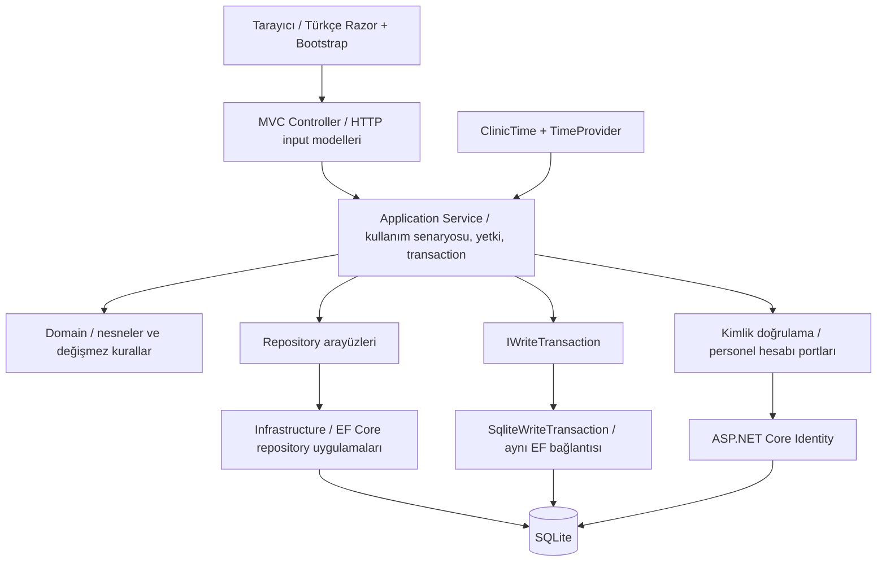
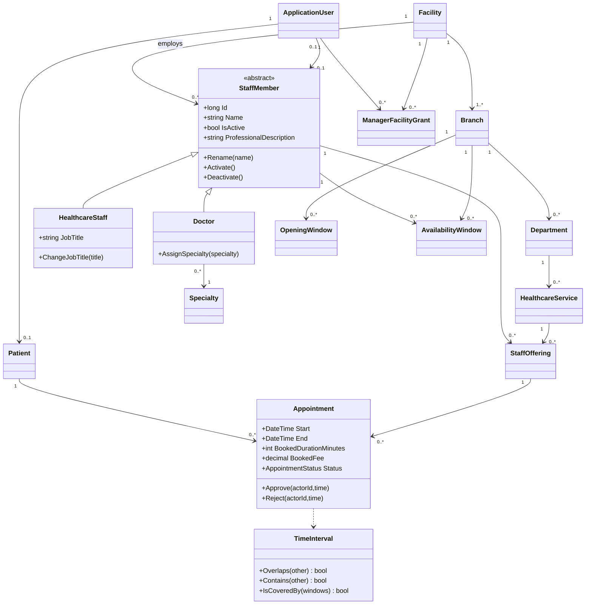

# Klinik Randevu — Türkçe sunum rehberi

Bu rehber 27 Ekim 2026 tarihindeki C# uygulamasını anlatır. Yalnızca kurgusal hesaplar ve veriler kullanılır. [Öğretmen gereksinimleri denetimi](REQUIREMENTS_AUDIT.md), [mimari inceleme](ARCHITECTURE_REVIEW.md), [çalıştırma rehberi](RUN_ON_WINDOWS.md) ve [gerçek doğrulama sonuçları](STAGE4_VERIFICATION.md) ile birlikte okunmalıdır.

## 1. Açılış: proje ne yapıyor?

“Projemiz, hastane ve kliniklerin şubelerini, bölümlerini, hizmetlerini ve çalışan takvimlerini yönetmesini sağlar. Hasta uygun hizmeti, çalışanı ve saati seçer. Sistem işlemin tamamının uygunluğunu ve çakışmaları denetleyerek onay bekleyen bir randevu kaydeder. Atanmış çalışan veya yetkili yönetici randevuyu onaylar ya da reddeder. Hasta sonucu kendi hesabından takip eder. Nesneye dayalı programlama ilkelerini gerçek çalışan farklılıklarını modellemek ve geçersiz durumları önlemek için kullandık.”

Kapsam randevu yönetimidir; teşhis, tıbbi kayıt veya ödeme işlemi yoktur. Yazılı ödev metni dil seçimini serbest bıraksa da hocamızın sonradan ilettiği **C# talimatına göre** bu uygulama C# ile hazırlanmıştır. Önceki Java projesi yalnızca okunabilir davranış referansıdır; Java/H2 kilitlemesi SQLite'a kopyalanmamıştır.

## 2. Teknolojiler ve görevleri

| Teknoloji | Projedeki görevi |
| --- | --- |
| C# / .NET 10; doğrulanan SDK 10.0.403 | Sınıflar, kalıtım, arayüzler, record veri modelleri, decimal ve tarih/saat işlemleri. |
| ASP.NET Core MVC / Razor | HTTP istekleri, form doğrulama ve sunucuda oluşturulan Türkçe sayfalar. |
| EF Core 10.0.14 / SQLite | Domain nesnelerinin kalıcı saklanması, ilişkiler, sorgular ve migration'lar. |
| ASP.NET Core Identity | Parola özetleme, oturum çerezleri, roller ve hatalı giriş kilitlemesi. |
| Bootstrap 5.3.8 + yerel CSS | Duyarlı ve tutarlı formlar, tablolar, gezinme ve durum göstergeleri; CDN kullanılmaz. |
| Yerleşik dependency injection | Servis, repository, saat ve işlem bağımlılıklarının constructor üzerinden sağlanması. |
| xUnit v3 / WebApplicationFactory | Domain, Application ve gerçek SQLite/HTTP bütünleşme testleri. |
| Git / GitHub | Gerçek geliştirme geçmişi ve ayrı C# deposu. Tarihler değiştirilmez. |

## 3. Katmanlı mimari



Çözümde dört üretim projesi vardır:

- **HospitalAppointments.Domain:** Framework bağımsız iş nesneleri. EF Core veya ASP.NET Core referansı yoktur.
- **HospitalAppointments.Application:** Kullanım senaryoları, iş kuralları, yetkilendirme, transaction sınırları, repository portları ve okunabilir DTO'lar. Yalnızca Domain'e bağımlıdır.
- **HospitalAppointments.Infrastructure:** EF eşlemeleri, sorgular, SQLite transaction uygulaması, Identity ve demo başlangıç verileri.
- **HospitalAppointments.Web:** Controller, HTTP form modelleri, Razor sayfaları ve `Program.cs` içindeki DI bileşimi.

Örnek akış: `BookingController.Book` → `AppointmentService.BookAsync` → `IBookingCatalogRepository` / `IScheduleRepository` / `IAppointmentRepository` → EF repository'leri → SQLite. Controller uygunluk hesaplamaz ve veritabanını doğrudan sorgulamaz. Domain nesnesi de repository çağırmaz. Form modelleri domain nesnelerine doğrudan bağlanmaz.

## 4. OOP ilkelerini kod üzerinde gösterme

| İlke | Açılacak gerçek C# örneği | Anlatım |
| --- | --- | --- |
| Kapsülleme | `Domain/Appointments/Appointment.cs`: private setter'lar, `Approve`, `Reject`, `Decide`; `Catalog/HealthcareService.cs`: `UpdateDetails` | Dışarıdan durum/ücret doğrudan atanmaz. Geçersiz değişiklik önce doğrulanır; nesne kısmen bozulmaz. Birden çok nesneyi ilgilendiren kurallar serviste ve transaction içinde denetlenir. |
| Kalıtım | `Domain/Staff/StaffMember.cs`, `Doctor.cs`, `HealthcareStaff.cs` | İsim, kurum, hesap bağlantısı ve etkinlik ortak; doktorun uzmanlığı, diğer çalışanın meslek bilgisi farklıdır. |
| Soyutlama | `StaffMember.ProfessionalDescription`; Application repository/transaction arayüzleri | Ortak sözleşme ne yapılacağını belirtir. İşlem mantığı SQLite ayrıntısını veya parola algoritmasını bilmez. |
| Çok biçimlilik | `BookingPageService.PageAsync`, `AppointmentService.ViewAsync`, `ManagementQueryService.PageAsync` | `staff.ProfessionalDescription` doktor için uzmanlık, sağlık personeli için meslek döndürür. Aynı randevu algoritması iki alt türle de çalışır. |
| Composition | `StaffOffering`, `ManagerFacilityGrant`, Identity rolleri | Çalışanın hizmet yetkinliği ve şubesi ilişkiyle kurulur. Hasta/yönetici rolü için yapay bir kalıtım ağacı yoktur. |
| DI / bağımlılıkların tersine çevrilmesi | `AppointmentService` constructor'ı, `Infrastructure/DependencyInjection.cs`, `Web/Program.cs` | Servis kendi veritabanını oluşturmaz; ihtiyaç duyduğu sözleşmeler constructor ile verilir. Testlerde kontrollü saat kullanılabilir. |

Gerçek soyut/override sözleşmesi:

```csharp
// StaffMember
public abstract string ProfessionalDescription { get; }

// Doctor
public override string ProfessionalDescription => Specialty.Name;

// HealthcareStaff
public override string ProfessionalDescription => JobTitle;
```

SOLID'i şu şekilde açıklayın:

- **S:** Controller HTTP'ye, servis kullanım senaryosuna, repository kalıcılığa, domain yerel nesne kurallarına odaklanır.
- **O:** Ortak rezervasyon akışı mevcut çalışan alt türleri arasında değişmez. Yeni bir alt türün EF/UI eşlemesi gerektirebileceğini dürüstçe belirtin.
- **L:** Doktor ve diğer sağlık çalışanı aynı offering/uygunluk/randevu sözleşmesini yerine getirir; tabanda alt türün destekleyemediği yapay bir işlem yoktur.
- **I:** Tek bir dev CRUD arayüzü yerine amaç odaklı repository, güvenlik ve transaction portları vardır.
- **D:** Application, EF/HTTP sınıflarına değil Domain'e ve kendi portlarına dayanır. Infrastructure bu portları uygular; Web birleştirir.

Her sınıfa sırf isim olsun diye arayüz eklenmemiştir. Alt tür düzenleyicisindeki doktor/diğer çalışan ayrımı gerçek alan farklılığını karşılar; ortak randevu akışında tür kontrolü yoktur.

## 5. UML sınıf diyagramı



Diyagram domain ve önemli Identity ilişkilerini gösterir. Domain, `ApplicationUser` tipini kullanmaz; hesap ID'sini taşır, FK eşlemesini Infrastructure yapar. “En az bir şube” kuralı tek bir FK ile sağlanmaz; kurum/ilk şube/yönetici yetkisi servis tarafından atomik oluşturulur.

## 6. Veritabanını açıklama

- Aynı `ApplicationDbContext`, Identity ve iş tablolarını eşler. Yeni çalışan hesabı ile profil aynı transaction'a katılır.
- Doktor ve sağlık personeli **TPH** ile `StaffMembers` tablosunda tutulur; `StaffType` ayracı ve alt tür CHECK kısıtı vardır. C# kalıtımı gerçektir; her alt tür için ayrı tablo zorunlu değildir.
- `HealthcareService → Department → Branch → Facility` hizmetin yerini belirler. `StaffOffering` personel/hizmet eşleşmesidir; ayrı ve çelişkili bir personel-şube tablosu yoktur.
- `AvailabilityWindow` çalışan/şube için tarihli UTC başlangıç-bitiştir. `OpeningWindow` şubenin haftalık yerel çalışma aralıklarıdır.
- Para domain'de `decimal`, SQLite'ta tam sayı kuruş olarak tutulur: **775,50 TRY → 77550**. Kayan noktalı ücret hesabı veya sessiz yuvarlama yapılmaz.
- Zamanlar UTC tick olarak saklanır; giriş ve gösterim `Europe/Istanbul` üzerinden yapılır. Süre pozitif tam dakikadır.
- Randevu, hizmet/çalışan adını ve süre/ücret/para birimini kayıt anındaki değerleriyle saklar. Sonraki katalog değişikliği bunları değiştirmez. Kurum/şube adı ve meslek/uzmanlık açıklaması güncel bağlı kayıttan gösterilir.
- Geçmişe bağlı kayıtlar silinmez; hizmet, çalışan veya offering pasifleştirilir. İlişkilerde kısıtlayıcı FK'ler bulunur.
- Üç migration vardır: `InitialIdentity`, `BookingDomain`, `ExactMinorUnits`. Stage 4 için model değişikliği gerekmedi.

## 7. Randevu alma nasıl çalışır?

1. Hasta giriş yapar; kurum, şube, hizmet, çalışan ve tarih seçer. Seçimi değiştirdikten sonra **Uygun saatleri göster** ile alt listeleri yeniler. Klavyede seçim değiştirmek kendiliğinden sayfa göndermeye yol açmaz.
2. `BookingPageService`, `AvailabilityService` ile bütün işlem süresine uygun 15 dakikalık başlangıçları listeler. Liste sadece öneridir; saati rezerve etmez.
3. POST sadece offering, tarih, başlangıç ve görülen katalog sürümünü taşır. Hasta/karar veren kişi girişten, süre ve ücret sunucudaki hizmetten alınır.
4. `AppointmentService.BookAsync` yazma transaction'ını alır, yetkiyi ve güncel veriyi tekrar okur. Etkinlik, sürüm, gelecek zaman, açılış/uygunluk kapsamı ve hasta/çalışan çakışmaları denetlenir.
5. Randevu **Pending / Onay Bekliyor** olarak kayıt anı bilgileriyle kaydedilir. Commit başarılı olmadan başarı yanıtı verilmez. Pending de zamanı ayırır.
6. Atanmış STAFF veya kurum yetkili MANAGER, aynı güvenli transaction düzeniyle **Approved / Onaylandı** ya da **Rejected / Reddedildi** kararı verir. Karar yalnızca bir kez değişir; ret zamanı serbest bırakır.

Aralıklar `[başlangıç, bitiş)` biçimindedir: 10:00–10:30 ile 10:30–11:00 çakışmaz. 30 dakikalık işlem 11:00'de biten uygunluğa 10:30'da sığar, 10:45'te sığmaz. Öğle arası iki aralık arasındaki boşluktur; ücretsiz görünen başlangıç tek başına yeterli değildir.

## 8. SQLite eşzamanlılık açıklaması

“İki hasta aynı saati aynı anda görebilir. Bu yüzden sadece ekranda ‘boş’ göstermeye güvenmiyoruz. SQLite'a önce yazma sıramızı aldırıyoruz. Bir işlem güncel takvimi kontrol edip kaydını bitirirken ikinci yazan bekliyor. İkinci işlem sıra kendisine geldiğinde veriyi yeniden okuyor; artık ilk randevuyu görüp çakışmayı reddediyor. İlk işlem başarısız olursa kaydı geri alınır.”

Kod karşılığı `SqliteConnection.BeginTransaction(deferred: false)` ve aynı bağlantıda `Database.UseTransactionAsync` çağrısıdır. Bu `SqliteWriteTransaction` portunun uygulamasıdır. Booking, karar ve ilgili yapılandırma servisleri aynı protokolü kullanır; Identity yazıları da aynı DbContext'e katılır.

**WAL ikinci bir eşzamanlı yazan oluşturmaz**; okuyucuların yazanla birlikte çalışmasına yardım eder. Benzersiz başlangıç saati farklı başlangıçlı çakışmaları engellemez. `lock`/Semaphore gibi yalnızca bir süreci koruyan çözüm kullanılmaz. Bekleme sınırlıdır; yoğunlukta 503 ve güvenli geri dönüş vardır. Bu tercih ders demosu için anlaşılırdır; yüksek ölçekli hastane kapasitesi iddiası değildir.

Kanıt: ayrı SQLite bağlantılarıyla yarış testleri, ayrıca aynı dosyayı kullanan **iki ayrı Kestrel süreci**. Yönetici uygunluğu kısaltırken hasta rezervasyonu, saat değişikliği ile yeni vardiya, pasifleştirme ve katalog değişiklikleri de test edilir. Gelecek uygunluklar korunuyorsa tehlikeli açılış saati değişikliği randevu henüz yokken bile reddedilebilir.

## 9. Canlı gösterim sırası

Yaklaşık 8–10 dakika; hesaplar arasında çıkış yapın veya ayrı tarayıcı profilleri kullanın. Tüm standart demo hesaplarının parolası `KlinikDemo10!` değeridir. Yeni doktor için kurgusal kullanıcı adı ve güçlü bir demo parolası belirleyin. Gerçek hasta bilgisi kullanmayın.

1. Ana sayfada Türkçe arayüzü ve üç rolü gösterin. `manager` ile giriş yapıp **Kurum yönetimi** açın.
2. Benzersiz isimli kurgusal bir klinik ve ilk şubesini oluşturun. İsterseniz ikinci şube ekleyerek çok şubeyi gösterin. Bir bölüm oluşturun.
3. Bölüme 30 dakikalık, **775,50 TRY** ücretli bir hizmet ekleyin. Nokta/binlik ayırıcı yerine virgül kullanıldığını açıklayın.
4. Uzmanlık ekleyin; doktor kaydedip yeni bir personel girişi oluşturun. Doktora hizmeti atayın. Bu atama hizmetin şubesini de belirler.
5. Gelecekteki bir tarihin haftanın gününe 09:00–12:00 ve 13:00–17:00 çalışma aralıklarını girin. Aynı tarihe 09:00–12:00 doktor uygunluğu ekleyin.
6. `patient` ile yeni kurum/hizmet/doktoru seçin; alt seçimleri güncelleyin ve uygun bir 10:00 başlangıcıyla rezervasyon yapın. **Onay Bekliyor** ve kayıtlı ücret/süreyi gösterin.
7. Yeni doktor hesabıyla giriş yapın, atanmış randevuyu açıp **Onayla** seçin. Hasta olarak tekrar açıp **Onaylandı** sonucunu gösterin.
8. Yönetici olarak aynı uygunluğu 10:15'te bitecek şekilde değiştirmeyi deneyin. Kayıtlı 10:00–10:30 randevusu korunacağı için işlem reddedilir.
9. Hizmet ücretini değiştirin veya pasifleştirin. Önceki randevunun 775,50 TRY/30 dakika bilgileri değişmez. Pasif hizmete yeni randevu alınamaz.
10. İkinci bir uygun saatte laboratuvar/sağlık personeli rezervasyonunu göstererek ortak StaffMember sözleşmesini anlatın. Kendi rolüyle `lab` karar verebilir.
11. Uygulamayı durdurup aynı veritabanıyla yeniden açın; ayarlar ve onaylı randevu kalır. Eski demo tarihlerini başlangıçta kontrol edin; yeniden başlatmak tarihleri ileri taşımaz.

Kısa ek kontroller: `clinicmanager` hastane/başka klinik yönetimini açamaz; `patient2` ilk hastanın randevu ayrıntısını göremez. Tab ile **İçeriğe geç**, form etiketleri, durum metinleri ve dar ekranda tablo kaydırmasını gösterin. İptal, ödeme veya tıbbi kayıt düğmesi varmış gibi anlatmayın.

## 10. Muhtemel hoca soruları

| Soru | Kısa, doğru cevap |
| --- | --- |
| Neden abstract StaffMember? | Ortak çalışan kimliği ve uygunluk/atama davranışı var; mesleki açıklama alt türe göre değişiyor. Tek başına genel bir çalışan oluşturmak yerine iki somut tür kullanıyoruz. |
| Polymorphism nerede? | `staff.ProfessionalDescription` çağrısı Doctor için uzmanlık, HealthcareStaff için meslek döndürür. Ortak booking akışı tür kontrolü yapmaz. |
| Neden Manager/Patient kalıtım ağacında değil? | Bunlar hesap yetkileri/profilleridir. Aynı hesaba roller bileşimle atanabilir; mesleki çalışan türüyle karıştırılmaz. |
| Private setter yeterli mi? | Tek başına değil. Constructor ve named method yerel geçerliliği, servisler çapraz nesne/yetki/transaction kurallarını koruyor. |
| Neden Controller içinde sorgu yok? | HTTP ile iş kurallarını ayırmak, doğrudan servis çağrısında da yetkilendirmek ve test edebilmek için. |
| EF Core neden Domain'de değil? | Domain iş kurallarını framework olmadan kullanabilmek için; Fluent API Infrastructure'da, tek domain modeli eşleniyor. |
| İki kişi aynı anda rezervasyon yaparsa? | SQLite yazma sırası kontrol okumalarından önce alınır. İkinci işlem ilk commit'ten sonra taze veriyi görür. Ayrı bağlantı ve süreç testleri bunu doğrular. |
| Sadece unique saat yeterli mi? | Hayır. 10:00 ve 10:15'te başlayan iki 30 dakikalık işlem farklı başlangıçlara rağmen çakışır. Tam aralık kontrolü gerekir. |
| Pending neden zamanı tutuyor? | Onay beklerken aynı kaynak için ikinci söz verilmemesi için. Rejected bırakır; bu sürümde otomatik süre aşımı yoktur. |
| Fiyat değişirse eski randevu? | Kayıt anındaki süre/ücret/adlar saklanır. Yeni rezervasyonda eski katalog sürümü görülürse tekrar inceleme istenir. |
| Parolalar nerede? | Identity özet olarak saklar; parola düz metin DTO'ya/loga/view'a çıkmaz. Demo parolaları bilerek kurgusal ve herkese açıktır. |
| Doktorun başka şube randevusu? | Çalışan çakışması tek şubeye daraltılmaz; personel kurum genelinde aynı kaynaktır. Hasta çakışması uygulama genelindedir. Yol süresi bu kapsamda yoktur. |
| 197 test neyi gösteriyor? | 31 Domain, 26 Application ve 140 Integration testi gerçekten çalıştı. 191 önceki test korunuyor. Tarihsel 118 Java testi, C# test sayısı değildir. |
| Proje teslimi tamamen tamam mı? | Teknik denetim ve sunum hazırlığı var. SABIS yükleme/katılım ve en az on gerçek farklı gündeki commit koşulu ayrıca tamamlanmalı; şu anda iki gerçek commit var. |

## 11. Sunumdan önce

- Başka bilgisayar için .NET/HTTPS kurulumunu [Windows rehberinden](RUN_ON_WINDOWS.md) yapın; son dakikada sertifika uyarısını atlamayın.
- Yerel Bootstrap dosyalarının, gelecekteki tarihin ve boş saatin hazır olduğunu kontrol edin. İlk restore internet gerektirir; hazırlanmış uygulama CDN kullanmaz.
- Gerçek sonuçları `docs/STAGE4_VERIFICATION.md` üzerinden anlatın; tüm olası güvenlik/ölçek koşullarının kanıtlandığını söylemeyin.
- Kaynak dosyalarını ve rehberi erişilebilir tutun. İstenirse Domain hiyerarşisini, AppointmentService'i ve SqliteWriteTransaction'ı doğrudan açın.
- Stage 4 değişiklikleri mevcut talimatla commit/push edilmemiştir. GitHub'daki checkpoint ile yerel son teslim arşivinin farkını dürüstçe belirtin; yeni izin olmadan ek push yapmayın.
- SABIS son tarihi/formatı, seçim kaydı, grup ve katılımı hocanın duyurusundan doğrulayın. Tarih veya commit geçmişi üretmeyin.
