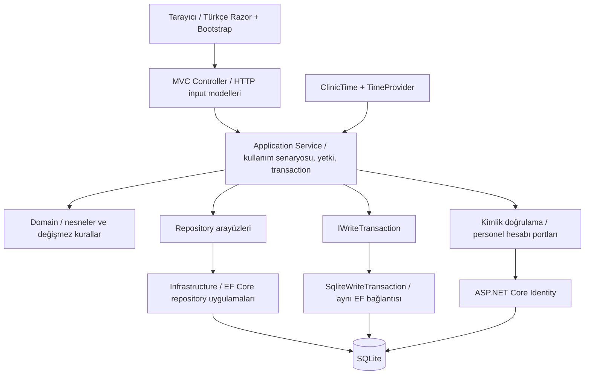
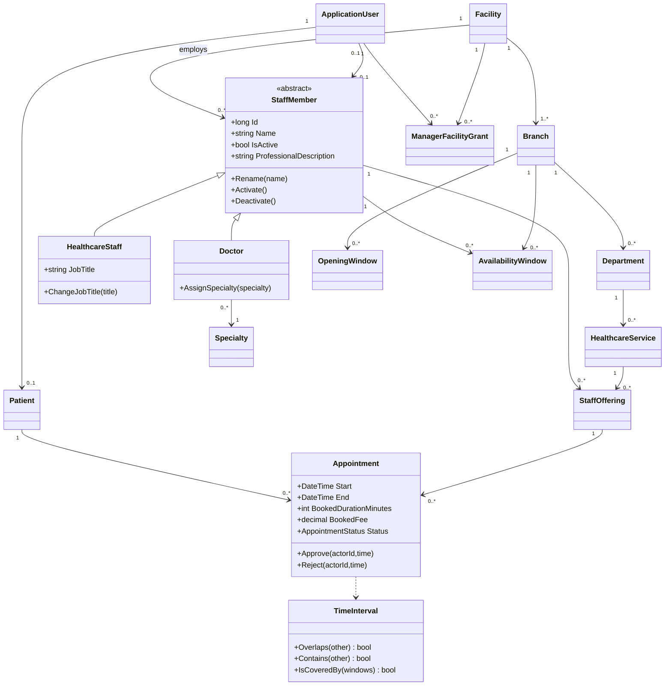

# Klinik Randevu — Türkçe sunum rehberi

Bu rehber **4 Kasım 2026** tarihinde mevcut C# kodu ve Razor formlarıyla karşılaştırılarak güncellendi. İzole Demo veritabanında gerçek Kestrel/HTTPS formları üzerinden yönetici → hasta → yeni doktor → hasta akışı, güvenli takvim reddi ve yeniden başlatma doğrulandı. Bu bir **HTTP provasıdır; bugün görsel tarayıcı veya klavye testi yapılmadı**. [Güncel prova ve 207 testin sonuçları](DAY9_VERIFICATION.md), [27 Ekim tarihli öğretmen denetimi](REQUIREMENTS_AUDIT.md), [mimari inceleme](ARCHITECTURE_REVIEW.md) ve [Windows kurulumu](RUN_ON_WINDOWS.md) ile birlikte kullanın. Verilerin tamamı kurgusaldır; eski doğrulama raporlarının tarihlerini güncel sonuçlarla karıştırmayın.

## 1. Açılış: proje ne yapıyor?

“Projemiz, hastane ve kliniklerin şubelerini, bölümlerini, hizmetlerini ve çalışan takvimlerini yönetmesini sağlar. Hasta uygun hizmeti, çalışanı ve saati seçer. Sistem işlemin tamamının uygunluğunu ve çakışmaları denetleyerek onay bekleyen bir randevu kaydeder. Atanmış çalışan veya yetkili yönetici randevuyu onaylar ya da reddeder. Hasta sonucu kendi hesabından takip eder. Nesneye dayalı programlama ilkelerini gerçek çalışan farklılıklarını modellemek ve geçersiz durumları önlemek için kullandık.”

Kapsam randevu yönetimidir; teşhis, tıbbi kayıt veya ödeme işlemi yoktur. Yazılı ödev metni dil seçimini serbest bıraksa da hocamızın sonradan ilettiği **C# talimatına göre** bu uygulama C# ile hazırlanmıştır. Önceki Java projesi yalnızca okunabilir davranış referansıdır; Java/H2 kilitlemesi SQLite'a kopyalanmamıştır.

## 2. Teknolojiler ve görevleri

| Teknoloji | Projedeki görevi |
| --- | --- |
| C# / .NET 10; doğrulanan SDK 10.0.403 | Sınıflar, kalıtım, arayüzler, record veri modelleri, decimal ve tarih/saat işlemleri. |
| ASP.NET Core MVC / Razor | HTTP istekleri, form doğrulama ve sunucuda oluşturulan Türkçe sayfalar. |
| EF Core 10.0.14 / SQLite | Domain nesnelerinin kalıcı saklanması, ilişkiler, sorgular ve migration'lar. |
| ASP.NET Core Identity | Parola özetleme, oturum çerezleri, roller ve hatalı giriş kilitlemesi. |
| Bootstrap 5.3.8 + yerel CSS | Duyarlı ve tutarlı formlar, tablolar, gezinme ve durum göstergeleri; CDN kullanılmaz. |
| Yerleşik dependency injection | Servis, repository, saat ve işlem bağımlılıklarının constructor üzerinden sağlanması. |
| xUnit v3 / WebApplicationFactory | Domain, Application ve gerçek SQLite/HTTP bütünleşme testleri. |
| Git / GitHub | Gerçek geliştirme geçmişi ve ayrı C# deposu. Tarihler değiştirilmez. |

## 3. Katmanlı mimari



Çözümde dört üretim projesi vardır:

- **HospitalAppointments.Domain:** Framework bağımsız iş nesneleri. EF Core veya ASP.NET Core referansı yoktur.
- **HospitalAppointments.Application:** Kullanım senaryoları, iş kuralları, yetkilendirme, transaction sınırları, repository portları ve okunabilir DTO'lar. Yalnızca Domain'e bağımlıdır.
- **HospitalAppointments.Infrastructure:** EF eşlemeleri, sorgular, SQLite transaction uygulaması, Identity ve demo başlangıç verileri.
- **HospitalAppointments.Web:** Controller, HTTP form modelleri, Razor sayfaları ve `Program.cs` içindeki DI bileşimi.

Örnek akış: `BookingController.Book` → `AppointmentService.BookAsync` → `IBookingCatalogRepository` / `IScheduleRepository` / `IAppointmentRepository` → EF repository'leri → SQLite. Controller uygunluk hesaplamaz ve veritabanını doğrudan sorgulamaz. Domain nesnesi de repository çağırmaz. Form modelleri domain nesnelerine doğrudan bağlanmaz.

## 4. OOP ilkelerini kod üzerinde gösterme

| İlke | Açılacak gerçek C# örneği | Anlatım |
| --- | --- | --- |
| Kapsülleme | [Appointment.cs](../src/HospitalAppointments.Domain/Appointments/Appointment.cs): private setter'lar, `Approve`, `Reject`, private `Decide`; [HealthcareService.cs](../src/HospitalAppointments.Domain/Catalog/HealthcareService.cs): `UpdateDetails` | `Status` dışarıdan atanmaz; Pending dışındaki randevu tekrar karara bağlanamaz. `UpdateDetails`, tüm yeni değerleri doğrulamadan mevcut adı/süreyi/ücreti değiştirmez. Çapraz nesne kuralları servistedir. |
| Kalıtım | [StaffMember.cs](../src/HospitalAppointments.Domain/Staff/StaffMember.cs), [Doctor.cs](../src/HospitalAppointments.Domain/Staff/Doctor.cs), [HealthcareStaff.cs](../src/HospitalAppointments.Domain/Staff/HealthcareStaff.cs) | Abstract taban sınıfta isim, kurum ve etkinlik ortaktır. `Doctor.AssignSpecialty` uzmanlığı, `HealthcareStaff.ChangeJobTitle` meslek bilgisini yönetir. |
| Soyutlama | `StaffMember.ProfessionalDescription`; [IAppointmentRepository](../src/HospitalAppointments.Application/Repositories/IBookingRepositories.cs) ve [IWriteTransaction](../src/HospitalAppointments.Application/Transactions/IWriteTransaction.cs) | Sözleşme gereken davranışı belirtir; EF sorgusunu ve SQLite'a özgü işlem açma ayrıntısını Infrastructure uygular. Her somut servise yapay bir arayüz eklenmemiştir. |
| Çok biçimlilik | [BookingPageService.PageAsync](../src/HospitalAppointments.Application/Services/BookingPageService.cs), [AppointmentService.ViewAsync](../src/HospitalAppointments.Application/Services/AppointmentService.cs), `ManagementQueryService.PageAsync` | Aynı `StaffMember` referansındaki `ProfessionalDescription`, doktor için `Specialty.Name`, sağlık personeli için `JobTitle` döndürür. Ekrandaki çalışan açıklaması bu override'lardan gelir; ortak randevu algoritması alt türe göre dallanmaz. |
| Composition | `StaffOffering`, `ManagerFacilityGrant`, Identity rolleri | Çalışanın hizmet yetkinliği ve şubesi ilişkiyle kurulur. Hasta/yönetici rolü için yapay bir kalıtım ağacı yoktur. |
| DI / bağımlılıkların tersine çevrilmesi | `AppointmentService` constructor'ı, `Infrastructure/DependencyInjection.cs`, `Web/Program.cs` | Servis kendi veritabanını oluşturmaz; ihtiyaç duyduğu sözleşmeler constructor ile verilir. Testlerde kontrollü saat kullanılabilir. |

Gerçek soyut/override sözleşmesi:

```csharp
// StaffMember
public abstract string ProfessionalDescription { get; }

// Doctor
public override string ProfessionalDescription => Specialty.Name;

// HealthcareStaff
public override string ProfessionalDescription => JobTitle;
```

SOLID'i şu şekilde açıklayın:

- **S:** Controller HTTP'ye, servis kullanım senaryosuna, repository kalıcılığa, domain yerel nesne kurallarına odaklanır.
- **O:** Ortak rezervasyon akışı mevcut çalışan alt türleri arasında değişmez. Yeni bir alt türün EF/UI eşlemesi gerektirebileceğini dürüstçe belirtin.
- **L:** Doktor ve diğer sağlık çalışanı aynı offering/uygunluk/randevu sözleşmesini yerine getirir; tabanda alt türün destekleyemediği yapay bir işlem yoktur.
- **I:** Tek bir dev CRUD arayüzü yerine amaç odaklı repository, güvenlik ve transaction portları vardır.
- **D:** Application, EF/HTTP sınıflarına değil Domain'e ve kendi portlarına dayanır. Infrastructure bu portları uygular; Web birleştirir.

Her sınıfa sırf isim olsun diye arayüz eklenmemiştir. Alt tür düzenleyicisindeki doktor/diğer çalışan ayrımı gerçek alan farklılığını karşılar; ortak randevu akışında tür kontrolü yoktur.

## 5. UML sınıf diyagramı



Diyagram domain ve önemli Identity ilişkilerini gösterir. Domain, `ApplicationUser` tipini kullanmaz; hesap ID'sini taşır, FK eşlemesini Infrastructure yapar. “En az bir şube” kuralı tek bir FK ile sağlanmaz; kurum/ilk şube/yönetici yetkisi servis tarafından atomik oluşturulur.

## 6. Veritabanını açıklama

- Aynı `ApplicationDbContext`, Identity ve iş tablolarını eşler. Yeni çalışan hesabı ile profil aynı transaction'a katılır.
- Doktor ve sağlık personeli **TPH** ile `StaffMembers` tablosunda tutulur; `StaffType` ayracı ve alt tür CHECK kısıtı vardır. C# kalıtımı gerçektir; her alt tür için ayrı tablo zorunlu değildir.
- `HealthcareService → Department → Branch → Facility` hizmetin yerini belirler. `StaffOffering` personel/hizmet eşleşmesidir; ayrı ve çelişkili bir personel-şube tablosu yoktur.
- `AvailabilityWindow` çalışan/şube için tarihli UTC başlangıç-bitiştir. `OpeningWindow` şubenin haftalık yerel çalışma aralıklarıdır.
- Para domain'de `decimal`, SQLite'ta tam sayı kuruş olarak tutulur: **775,50 TRY → 77550**. Kayan noktalı ücret hesabı veya sessiz yuvarlama yapılmaz.
- Zamanlar UTC tick olarak saklanır; giriş ve gösterim `Europe/Istanbul` üzerinden yapılır. Süre pozitif tam dakikadır.
- Randevu, hizmet/çalışan adını ve süre/ücret/para birimini kayıt anındaki değerleriyle saklar. Sonraki katalog değişikliği bunları değiştirmez. Kurum/şube adı ve meslek/uzmanlık açıklaması güncel bağlı kayıttan gösterilir.
- Geçmişe bağlı kayıtlar silinmez; hizmet, çalışan veya offering pasifleştirilir. İlişkilerde kısıtlayıcı FK'ler bulunur.
- Üç migration vardır: `InitialIdentity`, `BookingDomain`, `ExactMinorUnits`. Stage 4 için model değişikliği gerekmedi.

## 7. Randevu alma nasıl çalışır?

1. Hasta giriş yapar; kurum, şube, hizmet, çalışan ve tarih seçer. Seçimi değiştirdikten sonra **Uygun saatleri göster** ile alt listeleri yeniler. Klavyede seçim değiştirmek kendiliğinden sayfa göndermeye yol açmaz.
2. `BookingPageService`, `AvailabilityService` ile bütün işlem süresine uygun 15 dakikalık başlangıçları listeler. Liste sadece öneridir; saati rezerve etmez.
3. POST sadece offering, tarih, başlangıç ve görülen katalog sürümünü taşır. Hasta/karar veren kişi girişten, süre ve ücret sunucudaki hizmetten alınır.
4. `AppointmentService.BookAsync` yazma transaction'ını alır, yetkiyi ve güncel veriyi tekrar okur. Etkinlik, sürüm, gelecek zaman, açılış/uygunluk kapsamı ve hasta/çalışan çakışmaları denetlenir.
5. Randevu **Pending / Onay Bekliyor** olarak kayıt anı bilgileriyle kaydedilir. Commit başarılı olmadan başarı yanıtı verilmez. Pending de zamanı ayırır.
6. Atanmış STAFF veya kurum yetkili MANAGER, aynı güvenli transaction düzeniyle **Approved / Onaylandı** ya da **Rejected / Reddedildi** kararı verir. Karar yalnızca bir kez değişir; ret zamanı serbest bırakır.

Aralıklar `[başlangıç, bitiş)` biçimindedir: 10:00–10:30 ile 10:30–11:00 çakışmaz. 30 dakikalık işlem 11:00'de biten uygunluğa 10:30'da sığar, 10:45'te sığmaz. Öğle arası iki aralık arasındaki boşluktur; ücretsiz görünen başlangıç tek başına yeterli değildir.

## 8. SQLite eşzamanlılık açıklaması

“İki hasta aynı saati aynı anda görebilir. Bu yüzden sadece ekranda ‘boş’ göstermeye güvenmiyoruz. SQLite'a önce yazma sıramızı aldırıyoruz. Bir işlem güncel takvimi kontrol edip kaydını bitirirken ikinci yazan bekliyor. İkinci işlem sıra kendisine geldiğinde veriyi yeniden okuyor; artık ilk randevuyu görüp çakışmayı reddediyor. İlk işlem başarısız olursa kaydı geri alınır.”

Kod karşılığı `SqliteConnection.BeginTransaction(deferred: false)` ve aynı bağlantıda `Database.UseTransactionAsync` çağrısıdır. Infrastructure'daki [SqliteWriteTransaction](../src/HospitalAppointments.Infrastructure/Persistence/SqliteWriteTransaction.cs), Application'ın `IWriteTransaction` arayüzünü uygular. Önce yazma sırası alınır, sonra güncel yetki/takvim/çakışma okunur, kaydedilir ve commit edilir. Hata varsa dispose geri alır. Booking, karar ve ilgili yapılandırma servisleri aynı protokolü kullanır; yeni personelin Identity yazıları da aynı DbContext'e katılır.

**WAL ikinci bir eşzamanlı yazan oluşturmaz**; okuyucuların yazanla birlikte çalışmasına yardım eder. Benzersiz başlangıç saati farklı başlangıçlı çakışmaları engellemez. `lock`/Semaphore gibi yalnızca bir süreci koruyan çözüm kullanılmaz. Bekleme sınırlıdır; yoğunlukta 503 ve güvenli geri dönüş vardır. Bu tercih ders demosu için anlaşılırdır; yüksek ölçekli hastane kapasitesi iddiası değildir.

Kanıt: ayrı SQLite bağlantılarıyla yarış testleri, ayrıca aynı dosyayı kullanan **iki ayrı Kestrel süreci**. Yönetici uygunluğu kısaltırken hasta rezervasyonu, saat değişikliği ile yeni vardiya, pasifleştirme ve katalog değişiklikleri de test edilir. Gelecek uygunluklar korunuyorsa tehlikeli açılış saati değişikliği randevu henüz yokken bile reddedilebilir.

## 9. Canlı gösterim: hazırlık ve 8–10 dakikalık rota

### 9.1. Dersten önce hazırlayın

Kaynak çözümün kökünde build/test kontrollerini önceden tamamlayın; sınıfta restore beklemeyin. SDK ve HTTPS sertifikası için [Windows rehberini](RUN_ON_WINDOWS.md) izleyin. Standart kurgusal hesapları ve yayımlanmış demo parolasını [README tablosundan](../README.md#synthetic-demo-accounts) önceden kontrol edin. Yeni doktor için benzersiz bir kullanıcı adı ve güçlü bir **kurgusal** parola not edin; gerçek parola veya hasta bilgisi kullanmayın.

Asıl Demo verisini değiştirmeden prova için aşağıdaki komutu kullanın. Uygulama klasörü/veritabanını kendisi oluşturur:

```powershell
$demoFolder = Join-Path $PWD ('TestResults/presentation-' + (Get-Date -Format 'yyyyMMdd-HHmmss'))
$demoDatabase = Join-Path $demoFolder 'clinic.db'
dotnet run --no-launch-profile --project src/HospitalAppointments.Web -- --environment Demo --Database:Path $demoDatabase --urls https://localhost:7249
```

Tarayıcıda **https://localhost:7249** açın. Bu klasör Git'e alınmaz. Terminalde Ctrl+C ile yalnızca bu sunum uygulamasını durdurun. **Yeniden başlatırken yeni klasör üretmeyin:** aynı PowerShell penceresinde, aynı `$demoDatabase` ile yalnızca son `dotnet run` komutunu tekrar çalıştırın. Hazır Release klasörüyle çalışacaksanız content root ve veritabanı yolunu Windows rehberindeki gibi açıkça belirleyin.

Gösterim tarihi **D**, İstanbul'da bugünden iki gün sonrası olsun; tarih ile haftanın gününü not edin. Örneğin 4 Kasım provasında D = **6 Kasım 2026, cuma** idi; bu tarihi sonraki derslerde sabit kullanmayın. Başka bir PowerShell penceresinde hesaplayabilirsiniz:

```powershell
$demoDate = [TimeZoneInfo]::ConvertTimeFromUtc([DateTime]::UtcNow, [TimeZoneInfo]::FindSystemTimeZoneById('Europe/Istanbul')).Date.AddDays(2)
$demoDate.ToString('yyyy-MM-dd')
$demoDate.ToString('dddd', [Globalization.CultureInfo]::GetCultureInfo('tr-TR'))
```

Şu örnek değerleri önceden bir notta tutun: **Sunum Kliniği [saat]**, **Merkez Sunum**, **Genel Bakım**, **Sunum muayenesi**, **30 dakika**, **775,50 TRY**, **Sunum Uzmanlığı [saat]**, **Dr. Sunum Deniz**, `sunum-doktor-[saat]`. Köşeli kısmı gerçek saat veya başka benzersiz ekle değiştirin. Yeni kurum ve randevu sayfasının adresini kaydedin; veritabanları arasında ID'lerin aynı olacağını varsaymayın.

### 9.2. Konuşma planı

Hedef süre aşağıdaki **8–10 dakikadır**; insanın tarayıcıda form doldurma süresi bugün ölçülmedi. Örnek alanları önceden hazırlayın. İkinci şube, ücret değişikliği ve ek laboratuvar rezervasyonunu zorunlu rotaya sıkıştırmayın; çok şubeli yapı ve iki çalışan türü hazır kayıtlarda/kodda ayrıca gösterilebilir.

| Süre | Gösterilecek adım | Söylenecek ana fikir |
| --- | --- | --- |
| 0:00–0:40 | Ana sayfa, üç rol | “Hasta randevu alır; atanmış personel veya kurum yetkili yönetici değerlendirir.” |
| 0:40–2:00 | Yeni klinik, ilk şube, bölüm ve hizmet | “Hizmetin yeri, süresi ve ücreti sunucuda kayıtlıdır.” |
| 2:00–3:20 | Uzmanlık, doktor girişi, hizmet ataması | “Uzmanlık tek başına hizmet yetkisi vermez; ayrıca atama gerekir.” |
| 3:20–4:30 | Haftalık saatler ve tarihli uygunluk | “İki ayrı takvim var; işlem süresinin tamamı ikisine de sığmalıdır.” |
| 4:30–5:20 | Hasta rezervasyonu | “Onay Bekliyor da zamanı ayırır; 10:00–10:30, 30 dakikadır.” |
| 5:20–6:10 | Yeni doktor onayı, hasta sonucu | “Karar aktörü ve zamanı kaydedilir; hasta Onaylandı görür.” |
| 6:10–7:10 | Güvensiz değişiklik, aynı dosyayla restart | “Korunan randevuyu bozacak düzenleme reddedilir; veri kalıcıdır.” |
| 7:10–9:00 | OOP kaynakları ve katman diyagramı | Bölüm 4'teki dosyaları ve bölüm 8'deki yazma sırası açıklamasını kullanın. |
| 9:00–10:00 | Hocanın soruları | Bölüm 10'daki kısa cevaplardan ilerleyin. |

### 9.3. Ekranda tam olarak ne yapılacak?

1. **Giriş yap → manager → Kurum yönetimi** (`/manager/facilities`). **Yeni kurum** formunda Kurum adı = örnek klinik, Kurum türü = **Klinik**, İlk şube adı = **Merkez Sunum**; **Kurumu oluştur**. **Beklenen:** kurumun başlığı ve **Şubeler ve bölümler** sayfası açılır; ilk şube zaten vardır. Aynı şubeyi tekrar eklemeyin.
2. Aynı sayfada **Yeni bölüm**: Şube = Merkez Sunum, Bölüm adı = **Genel Bakım**; **Bölüm ekle**. **Beklenen:** bölüm listede görünür. Sonra **Hizmetler ve ücretler** sekmesi → **Yeni sağlık hizmeti**: Şube / bölüm = Merkez Sunum / Genel Bakım, Hizmet adı = Sunum muayenesi, Süre = 30, Ücret = **775,50**; **Hizmet ekle**. **Beklenen:** etkin hizmet satırı. Nokta veya binlik ayırıcı kullanmayın.
3. **Çalışanlar ve atamalar → Doktor uzmanlıkları**: yeni uzmanlık adını yazıp **Uzmanlık ekle**. **Doktor kaydı**: Ad soyad = Dr. Sunum Deniz, Uzmanlık = az önce eklenen değer. **İsteğe bağlı personel girişi** altındaki **Yeni kullanıcı adı ve Yeni parola alanlarını bu senaryoda ikisini de doldurun**, ardından **Doktoru kaydet**. **Beklenen:** çalışan listesinde doktor, uzmanlık ve giriş hesabı bilgisi. Alanlar boş bırakılırsa doktor kaydı oluşabilir ama onunla giriş yapılamaz; bu prova için hesap gereklidir.
4. Aynı sayfada **Hizmet ve şube ataması**: Çalışan = yeni doktor, Şube / hizmet = yeni hizmet; **Hizmet ata**. **Beklenen:** atama tablosunda doğru doktor, Merkez Sunum ve Sunum muayenesi **Etkin** görünür.
5. **Saatler ve uygunluk → Şube çalışma saatleri**: Şube = Merkez Sunum, Gün = **D'nin haftanın günü**, ardından mutlaka **Saatleri göster**. Alttaki başlığın doğru şube/gün olduğunu kontrol edin. 1. aralık = **09:00–12:00**, 2. aralık = **13:00–17:00**, diğerleri boş; **Günün saatlerini kaydet**. **Beklenen:** **Haftalık saatlerin tamamı** açıldığında doğru günün iki aralığı görünür. Gün seçimini değiştirmek tek başına alttaki kaydetme formunu güncellemez.
6. Aynı sayfada **Tarihli çalışan uygunluğu**: Çalışan = yeni doktor, Şube = Merkez Sunum, Tarih = **D**, Başlangıç = **09:00**, Bitiş = **12:00**; **Uygunluk ekle**. **Beklenen:** **Kayıtlı uygunluklar** altında D grubunu açınca doktor/şube/09:00–12:00 kaydı görünür. Haftalık saat girmek tek başına doktoru uygun yapmaz.
7. **Çıkış yap → Giriş yap → patient → Randevu al** (`/patient/book`). Yeni kurum/şube/hizmet/doktoru ve D'yi seçin. Üst seçimi değiştirdikçe **Uygun saatleri göster** ile alt listeleri yenileyin. **10:00** düğmesine basın. **Beklenen:** ayrıntıda **Onay Bekliyor**, **10:00–10:30**, **30 dakika**, **775,50 TRY**; adresi not edin. Yalnızca saati görüntülemek rezervasyon değildir; saat düğmesinin POST'u kaydeder.
8. **Çıkış yap → Giriş yap → yeni doktorun kullanıcı adı/parolası → Randevu değerlendirme** (`/work/appointments`). Kayıtlı randevuyu açıp **Onayla**. Ardından **Çıkış yap → patient ile giriş → Randevularım → aynı kayıt**. **Beklenen:** **Onaylandı**, değişmeyen süre/ücret ve karar zamanı. Onay için `staff` adlı eski demo doktorunu kullanmayın; bu randevu yeni doktora atanmıştır.
9. **Çıkış yap → manager ile giriş → Kurum yönetimi → oluşturulan klinik → Saatler ve uygunluk**. **Kayıtlı uygunluklar** altında D'yi açın; aynı kaydın Bitiş değerini **10:15** yapıp **Kaydet**. **Beklenen:** Türkçe ret açıklaması (HTTP 409); 10:00–10:30 randevusu bozulmaz. Geri dönüp kaydı yenileyin: bitiş hâlâ **12:00** olmalıdır. Bu, beklenen güvenlik davranışıdır. Aynı saatin ikinci rezervasyonda listelenmemesi de çakışma önlemesidir; ekranda olmayan bir düğme varmış gibi göstermeyin.
10. Kendi sunum uygulamanızı durdurup **aynı `$demoDatabase` ile** yeniden başlatın. Patient ile giriş yapıp not edilen randevuyu açın; manager ile de aynı kliniği ve uygunluğu açın. **Beklenen:** aynı kayıt adresi, **Onaylandı**, 775,50 TRY/30 dakika ve 09:00–12:00 uygunluğu korunur. Yeni doktorla giriş de hâlâ çalışır. Restart yeni bir demo takvimi üretmez.

### 9.4. Beş dakikalık yedek ve süresi geçmiş seed takvimi

Ana rota, yeni doktor için D tarihinde uygunluk girdiğinden eski seed tarihlerine bağlı değildir. Süre kısıtlıysa yapılandırmayı **prova sırasında önceden oluşturduğunuzu açıkça söyleyin**, kaydedilmiş klinik/şube/hizmet/doktoru gösterip 7–10. adımları canlı yapın. Önceden yapılmış kurulumun ekranda o anda oluşturulduğunu söylemeyin.

Hazır demo doktoruyla hızlı yedek: `manager` → **Kurum yönetimi → Demo Bakım Hastanesi → Saatler ve uygunluk**. Kuzey şubesinin D günündeki saatlerinin en az 09:00–11:00'ı kapsadığını kontrol edin. **Dr. Deniz (Demo) / Kuzey / D / 09:00–11:00** uygunluğu yoksa ekleyin; zaten varsa tekrar eklemeyin. `patient` → aynı kurum / Kuzey / Genel muayene / Dr. Deniz / D → **Uygun saatleri göster → 10:30**. Bu 30 dakikalık işlem 11:00'de biter; 10:45 sığmaz. Bu yedekte onaylayacak hesap **staff**'tır. Doluysa başka boş tarih/saat seçin. Bu yöntem asıl veriyi silmeden takvimi uzatır; yeniden başlatma eski tarihleri ileri taşımaz.

Ücret değişikliği/geçmiş snapshot, başka kişinin kaydına erişim reddi, çok şube ve laboratuvar çalışanını yalnızca ek süre varsa gösterin. İptal, ödeme veya tıbbi kayıt özelliği varmış gibi anlatmayın.

## 10. Muhtemel hoca soruları

| Soru | Kısa, doğru cevap |
| --- | --- |
| Neden abstract StaffMember? | Ortak isim, kurum ve etkinlik durumu var; mesleki açıklama alt türe göre değişiyor. Uygunluk ve hizmet atamaları bu ortak çalışan tipine bağlanıyor. Tek başına genel bir çalışan yerine iki somut tür oluşturuyoruz. |
| Polymorphism nerede? | `staff.ProfessionalDescription` çağrısı Doctor için uzmanlık, HealthcareStaff için meslek döndürür. Ortak booking akışı tür kontrolü yapmaz. |
| Neden Manager/Patient kalıtım ağacında değil? | Bunlar hesap yetkileri/profilleridir. Aynı hesaba roller bileşimle atanabilir; mesleki çalışan türüyle karıştırılmaz. |
| Private setter yeterli mi? | Tek başına değil. Constructor ve named method yerel geçerliliği, servisler çapraz nesne/yetki/transaction kurallarını koruyor. |
| Neden Controller içinde sorgu yok? | HTTP ile iş kurallarını ayırmak, doğrudan servis çağrısında da yetkilendirmek ve test edebilmek için. |
| EF Core neden Domain'de değil? | Domain iş kurallarını framework olmadan kullanabilmek için; Fluent API Infrastructure'da, tek domain modeli eşleniyor. |
| İki kişi aynı anda rezervasyon yaparsa? | SQLite yazma sırası kontrol okumalarından önce alınır. İkinci işlem ilk commit'ten sonra taze veriyi görür. Ayrı bağlantı ve süreç testleri bunu doğrular. |
| Sadece unique saat yeterli mi? | Hayır. 10:00 ve 10:15'te başlayan iki 30 dakikalık işlem farklı başlangıçlara rağmen çakışır. Tam aralık kontrolü gerekir. |
| Pending neden zamanı tutuyor? | Onay beklerken aynı kaynak için ikinci söz verilmemesi için. Rejected bırakır; bu sürümde otomatik süre aşımı yoktur. |
| Fiyat değişirse eski randevu? | Kayıt anındaki süre/ücret/adlar saklanır. Yeni rezervasyonda eski katalog sürümü görülürse tekrar inceleme istenir. |
| Parolalar nerede? | Giriş veya yeni personel formu parolayı HTTPS üzerinden sunucuya iletir; Identity hash üretir/doğrular. Veritabanında açık parola tutulmaz. Okuma DTO'ları parola/hash taşımaz; hata ekranı girilen parolayı geri basmaz. Demo parolaları bilerek kurgusal ve herkese açıktır. |
| Doktorun başka şube randevusu? | Çalışan çakışması tek şubeye daraltılmaz; personel kurum genelinde aynı kaynaktır. Hasta çakışması uygulama genelindedir. Yol süresi bu kapsamda yoktur. |
| Yönetici rolü her kurumu açabilir mi? | Hayır. `BookingAccessService` ve `ManagementScope`, güncel hesap rolüne ek olarak `ManagerFacilityGrant` ile kurum yetkisini denetler. Rol aynı kalsa bile kurum yetkisi kaldırıldığında eski oturum o kurumun randevusunu açamaz/değiştiremez; Day 8 testleri kayıt/audit'in değişmediğini doğrular. |
| Onay formu tekrar gönderilirse? | Sadece Pending karar alabilir. Eski formun tekrar veya zıt kararı 409 ile reddedilir; ilk karar veren kişi, zaman ve sürüm korunur. Day 7 testleri bu HTTP akışını doğrular. |
| SQLite seçmek çok kullanıcıya yeter mi? | Bu yerel ders uygulamasında kısa yazma işlemlerini sıraya almak anlaşılır bir doğruluk çözümüdür. WAL birden çok yazan sağlamaz. Üretim hastanesi kapasitesi için yük testi/işletim tasarımı gerekir; bu ölçekte bir iddiamız yok. |
| 207 test neyi gösteriyor? | 4 Kasım'da 31 Domain, 26 Application ve 150 Integration testi geçti; önceki 207 test korundu. Bugün doküman/prova iyileştirildiği için sırf sayı artsın diye test eklenmedi. Tarihsel 118 Java çalıştırması C# test sonucu değildir. |
| Proje teslimi tamamen tamam mı? | Güncel C# kaynakları GitHub'dadır. SABIS yükleme makbuzu, son tarih, katılım ve en az on gerçek farklı gündeki commit şartı ayrıca doğrulanır. Sayıyı/tarihleri `git log --format="%h %cI %s"` ile gösterin; geçmiş tarihli rapordaki iki commit bilgisini bugünün durumu diye sunmayın. |

## 11. Sunumdan önce

- Başka bilgisayar için .NET/HTTPS kurulumunu [Windows rehberinden](RUN_ON_WINDOWS.md) yapın; son dakikada sertifika uyarısını atlamayın.
- Yerel Bootstrap dosyalarının, gelecekteki tarihin ve boş saatin hazır olduğunu kontrol edin. İlk restore internet gerektirir; hazırlanmış uygulama CDN kullanmaz.
- Güncel prova ve test sonuçlarını `docs/DAY9_VERIFICATION.md`, geçmiş Stage 4 sonuçlarını kendi tarihli raporu üzerinden anlatın. Diyagramı görüntüleyebilen bir Markdown önizlemesi ve bölüm 4'teki kaynak dosyalarını önceden açın.
- Kaynak dosyalarını ve rehberi erişilebilir tutun. İstenirse Domain hiyerarşisini, AppointmentService'i ve SqliteWriteTransaction'ı doğrudan açın.
- Eski Stage 4 ZIP'leri sonraki commit'lerle kendiliğinden güncellenmez. GitHub `main` kaynağıyla sunumda çalıştırdığınız klasörü karıştırmayın. Aktif veritabanını kaynak teslimine koymayın.
- SABIS son tarihi/formatı, seçim kaydı, grup ve katılımı hocanın duyurusundan doğrulayın. Tarih veya commit geçmişi üretmeyin.

## 12. Sunum aksarsa hızlı kontrol

| Belirti | Yapılacak somut kontrol |
| --- | --- |
| `dotnet`/SDK bulunamıyor | Çözüm kökünde `dotnet --version`; proje `global.json` ve doğrulanan 10.0.403 SDK. Kurulum için Windows rehberini kullanın. |
| HTTPS uyarısı | Doğru `https://localhost:7249` adresi. Hedef bilgisayarın kullanıcısı Windows rehberindeki `dotnet dev-certs https --trust` komutunu çalıştırıp kendi onayını verir. Uyarıyı atlamayın. |
| Port dolu / DLL kilitli | Yalnızca kendi önceki sunum uygulamanızı Ctrl+C ile durdurun; başka uygulamayı kapatmayın. Gerekirse `--urls` ve tarayıcı adresini birlikte farklı boş porta taşıyın. Build/publish sırasında kendi çalışan hostunuzu durdurun. |
| Giriş başarısız | Doğru Demo dosyası ve ortam mı? Yeni doktorun kullanıcı adını nottan kontrol edin. Beş yanlış deneme beş dakika kilitler; restart parolayı sıfırlamaz. |
| Doktor/saat çıkmıyor | Etkin hizmet ve çalışan, doğru şubeye hizmet ataması, D'nin haftalık saatleri ve D için ayrı uygunluk var mı? Seçimleri **Uygun saatleri göster** ile yenileyin. Süre öğle arasını aşmamalı; hasta/çalışan dolu olmamalı. |
| Yanlış haftanın günü kaydedildi | Şube/gün seçtikten sonra **Saatleri göster**; alttaki başlığın doğru olduğuna bakıp sonra **Günün saatlerini kaydet**. |
| 409 ret ekranı | Çakışma veya ayrılmış zamanı bozan düzenleme olabilir; mesajı okuyun. Güvensiz 10:15 değişikliğinin reddi bu gösterimde beklenir. Form girdisi otomatik geri dolmayabilir; yönetim sayfasına dönüp kayıtlı değeri kontrol edin. |
| 503 meşgul | Başka yazan işlemin bitmesini bekleyip yeni istekle deneyin. Başarı varsaymayın; randevu listesinden sonucu kontrol edin. |
| Restart sonrası veriler farklı | Aynı `$demoDatabase` mi, aynı içerik kökü mü? Yeni zaman damgalı klasör oluşturmak başka bir veritabanı açar. Kayıtlı randevu/kurum adresini ve terminaldeki dosya yolunu karşılaştırın; asıl dosyayı silmeyin. |

Uygulama hiç açılamıyorsa kaynak diyagramlarını ve son gerçek doğrulama raporunu gösterin; bunu canlı çalışan demo diye adlandırmayın. Kurulum/sunum ortamını düzeltip kaydedilmiş aynı izole dosyayla tekrar prova yapın.
